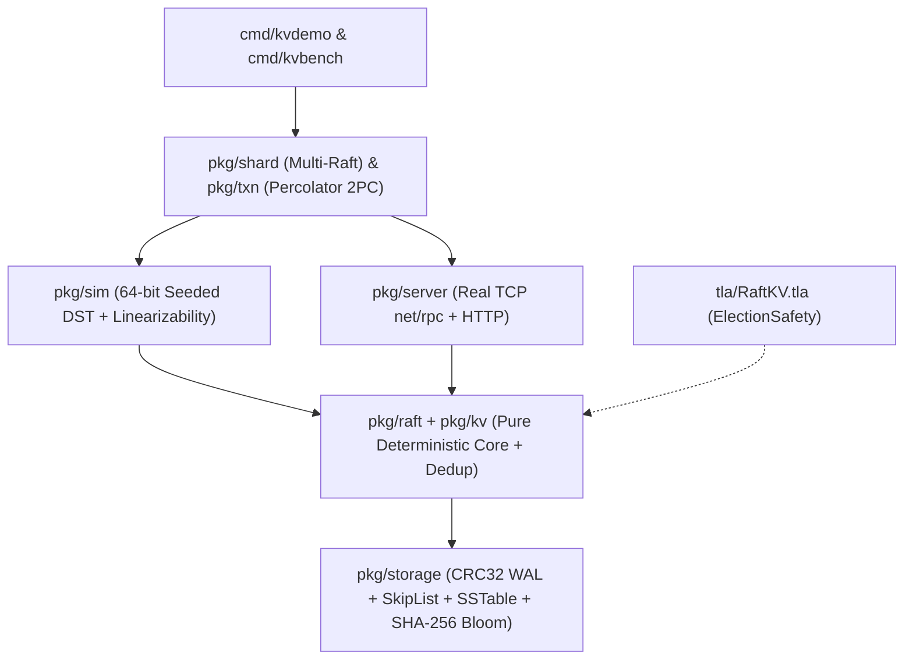

# TardiDB (`tardidb`)

[[https://github.com/swayamsaini/tardidb/actions/workflows/ci.yml/badge.svg]](https://github.com/swayamsaini/tardidb/actions/workflows/ci.yml)
[https://img.shields.io/badge/Go-1.22%2B-00ADD8?logo=go&logoColor=white]
[https://img.shields.io/badge/Dependencies-Zero-brightgreen]
[https://img.shields.io/badge/Tests-23%2F23%20Passing-success]
[https://img.shields.io/badge/License-MIT-blue]

> *Named after the **Tardigrade** ("water bear") — nature's most resilient organism, engineered to survive extreme fault-injection chaos without losing a single byte.*

A fault-tolerant, sharded distributed Key-Value database built from scratch in **pure Go** (zero external dependencies) with a custom **LSM-Tree storage engine**, **pure deterministic Raft consensus**, **Multi-Raft sharding**, **Percolator MVCC 2PC transactions**, a **Deterministic Simulation Testing (DST)** harness modeled after FoundationDB & TigerBeetle, and a formal **TLA+ specification**.

[docs/benchmarks.png]

## Measured Results (Windows 11 · AMD Ryzen 5 5600H)

| Component | Workload | Measured Result |
| :--- | :--- | :--- |
| **DST Chaos Swarm** (`pkg/sim`) | 30 seeded 5-node runs (drops, dups, partitions, crashes) | **2,694 linearizable ops** in **0.69s** (0 violations) |
| **Leader-Kill Failover** (`cmd/kvbench`) | 1,000 Puts + live `SIGKILL` on Leader Node 4 | **2,879 ops/sec**, **0 errors**, `p50=0.00ms`, `p99=8.14ms`, `p999=10.37ms` |
| **Real TCP Cluster** (`pkg/server`) | 3-node localhost `net/rpc` + HTTP `/put` & `/get` | Election + replication passing in **0.40s** |
| **WAL Persistence** (`pkg/storage`) | `file.Sync()` vs. buffered OS page cache | **2.83 ms/op** vs. **9.53 µs/op** (**297× `fsync` gap**) |

## Architecture



## Quickstart

```powershell
# Run all 23 tests across all 7 packages
go test -v ./...

# Launch live interactive 3-node TCP cluster (put / get / kill / status)
go run ./cmd/kvdemo

# Run 5-node open-loop benchmark with live Leader SIGKILL
go run ./cmd/kvbench

# Measure WAL fsync vs. NoSync latency
go test -bench="." ./pkg/storage
```

## Documentation

- [Architecture & Invariants](https://github.com/swayamsaini/tardidb/blob/main/docs/architecture.md)
- [Bugs Found by DST (Postmortems)](https://github.com/swayamsaini/tardidb/blob/main/docs/bugs-found-by-dst.md)
- [Engineering Blog Post](https://github.com/swayamsaini/tardidb/blob/main/docs/blog-post.md)