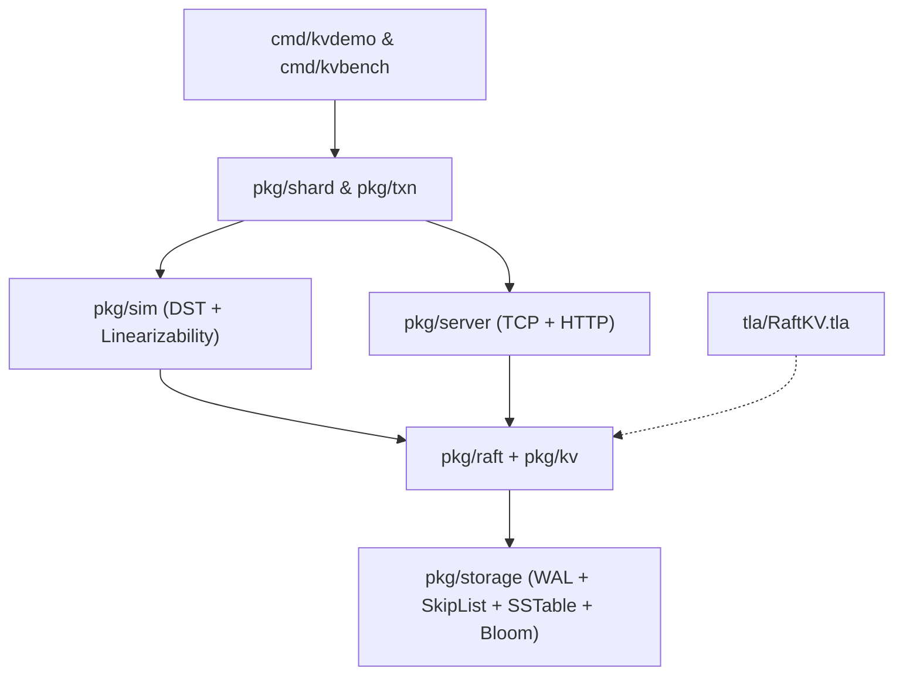

# TardiDB

[[https://github.com/swayamsaini/tardidb/actions/workflows/ci.yml/badge.svg]](https://github.com/swayamsaini/tardidb/actions/workflows/ci.yml)
[https://img.shields.io/badge/Go-1.22%2B-00ADD8?logo=go&logoColor=white]
[https://img.shields.io/badge/License-MIT-blue]

A distributed Key-Value store written from scratch in Go using only the standard library. Named after the tardigrade because the main goal of the project was surviving network partitions, packet reordering, and sudden leader kills without corrupting state.

It includes an LSM-tree storage engine, a pure deterministic Raft implementation, a discrete-event simulation harness with a linearizability checker, Multi-Raft sharding, Percolator-style 2PC transactions, and a small TLA+ spec for election safety.

[docs/benchmarks.png]

## Benchmarks & Test Runs

Measured on a Windows 11 laptop (AMD Ryzen 5 5600H):

| What | Workload | Result |
| :--- | :--- | :--- |
| DST Swarm (`pkg/sim`) | 30 seeded 5-node runs (drops, duplicates, partitions, crashes) | 2,694 linearizable ops in 0.69s (0 failures) |
| Failover Bench (`cmd/kvbench`) | 1,000 Puts with a mid-run `SIGKILL` on Leader Node 4 | 2,879 ops/sec, 0 errors, `p50=0.00ms`, `p99=8.14ms`, `p999=10.37ms` |
| TCP Cluster (`pkg/server`) | 3-node localhost cluster (`net/rpc` + HTTP) | Election + replication pass in 0.40s |
| WAL Sync (`pkg/storage`) | `file.Sync()` vs. buffered page cache | `2.83 ms/op` vs. `9.53 µs/op` (~297x difference) |

## How It Fits Together



## Running Locally

```powershell
# Run all 23 tests across all packages
go test -v ./...

# Run with Go's race detector
go test -race ./...

# Start an interactive 3-node local TCP cluster (supports: status, put, get, kill, quit)
go run ./cmd/kvdemo

# Run the 5-node leader-kill benchmark
go run ./cmd/kvbench

# Compare WAL fsync vs. non-fsync throughput
go test -bench="." ./pkg/storage
```

## Current Limitations

- `pkg/shard` and `pkg/txn` are tested standalone and are not yet wired into the `cmd/kvdemo` TCP server.
- `pkg/server` uses `net/rpc` and JSON over HTTP for simplicity; `proto/kvraft.proto` is included as the gRPC wire schema.
- `tla/RaftKV.tla` models core leader election and `ElectionSafety` rather than snapshots or membership changes.

## Notes

- [Architecture Notes](https://github.com/swayamsaini/tardidb/blob/main/docs/architecture.md)
- [Bugs Caught During Testing](https://github.com/swayamsaini/tardidb/blob/main/docs/bugs-found-by-dst.md)
- [Write-up](https://github.com/swayamsaini/tardidb/blob/main/docs/blog-post.md)