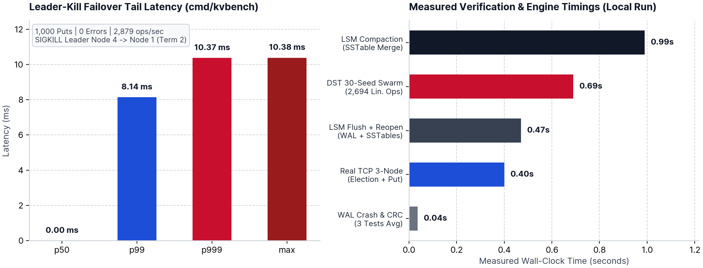

# TardiDB (`tardidb`)

A fault-tolerant, sharded Key-Value database built from scratch in Go with a custom **LSM-Tree storage engine**, **Raft consensus**, **Multi-Raft sharding**, **Percolator MVCC 2PC transactions**, and a **Deterministic Simulation Testing (DST)** harness modeled after FoundationDB and TigerBeetle.



## Measured Results (Local Windows 11 Run)
- **Deterministic Simulation Swarm (`pkg/sim`)**: **2,694** linearizable client operations verified across **30** seeded 5-node chaos runs in **0.69s** (`0` Raft safety or linearizability violations).
- **Leader-Kill Failover Benchmark (`cmd/kvbench`)**: **1,000 Puts** (`0` errors) with live `SIGKILL` on Leader Node 4 -> automatic failover to Node 1 (Term 2) at **2,879 ops/sec** (`p50=0.00ms`, `p99=8.14ms`, `p999=10.37ms`, `max=10.38ms`).
- **Real TCP 3-Node Cluster (`pkg/server`)**: Live localhost election + TCP log replication passing in **0.40s**.

## Architecture

- **`pkg/storage`**: Append-only binary WAL with CRC32 framing and torn-write crash recovery, sorted SkipList MemTable, immutable SSTables with SHA-256 double-hashed Bloom filters, and compaction.
- **`pkg/raft`**: Pure, zero-OS-I/O Raft state machine (`Tick` / `Propose` / `RequestReadIndex` / `Snapshot` / `HandleMessage` -> `[]Action`) with fast backtracking, Figure 8 commit safety, `InstallSnapshot`, and `ReadIndex`.
- **`pkg/kv`**: Deterministic KV state machine with `ClientID + SeqNum` idempotency deduplication persisted inside Raft snapshots.
- **`pkg/sim`**: Single-threaded, 64-bit-seeded discrete-event simulator injecting packet drops, duplicates, reordering, asymmetric partitions, node crashes/reboots, and snapshots—paired with continuous Raft invariant assertions and a P-compositionality linearizability checker.
- **`pkg/shard`**: Multi-Raft Shard Controller (`Join` / `Leave` / `Move` / `Query`) with minimal-movement rebalancing and online `Pushing -> Pull -> InstallShard -> DeleteShard` migration.
- **`pkg/txn`**: Percolator-style MVCC 2PC coordinator for atomic cross-shard multi-key transactions with Snapshot Isolation.
- **`pkg/server` & `proto/`**: Real TCP 3-node cluster server + HTTP API and gRPC Protocol Buffers contract (`proto/kvraft.proto`).
- **`pkg/obs` & `cmd/kvbench`**: `p50`/`p99`/`p999` latency telemetry and open-loop leader-kill failover benchmark.
- **`tla/`**: Formal TLA+ specification (`tla/RaftKV.tla` + `tla/RaftKV.cfg`) verifying `ElectionSafety`.

## Running Tests & Benchmarks

```powershell
# Run all 23 tests across all 7 packages
go test -v ./...

# Run storage WAL fsync vs. non-fsync benchmarks
go test -bench="." ./pkg/storage

# Run the 5-node leader-kill failover benchmark
go run ./cmd/kvbench
```

## Documentation

- [`docs/architecture.md`](docs/architecture.md) — System design, invariants, and measured results.
- [`docs/bugs-found-by-dst.md`](docs/bugs-found-by-dst.md) — Postmortems of real bugs caught during testing & simulation.
- [`docs/blog-post.md`](docs/blog-post.md) — Engineering write-up of the project and design trade-offs.
